  

 

## What I'm building

| Project | What it does | Stack |
|---|---|---|
| [**Vesa-OS**](https://github.com/vedant-B22/Vesa-OS) | Multi-tenant client and project management SaaS for the agency |  |
| [**Vesa-Comset**](https://github.com/vedant-B22/Vesa-Comset) | AI product intelligence platform (UniHack 2026) |  |
| [**Vesa-Leads**](https://github.com/vedant-B22/Vesa-Leads) | Lead generation and outreach automation |  |
| [**stadiumsense-ai**](https://github.com/vedant-B22/stadiumsense-ai) | AI for stadium crowd and experience |  |
| [**Election-Assist-Bot**](https://github.com/vedant-B22/Election-Assist-Bot) | Assistant bot for election info |  |
| [**vesa-transit**](https://github.com/vedant-B22/vesa-transit) | Transit tooling |  |

 

## Stack

 

## Numbers

 

 

## Contribution snake

  

 

## Work with Vesa Studios

Branding, websites and custom software for founders who want it to look sharp and actually work.
**Pitch me:** [vesastudios.site](https://vesastudios.site)

